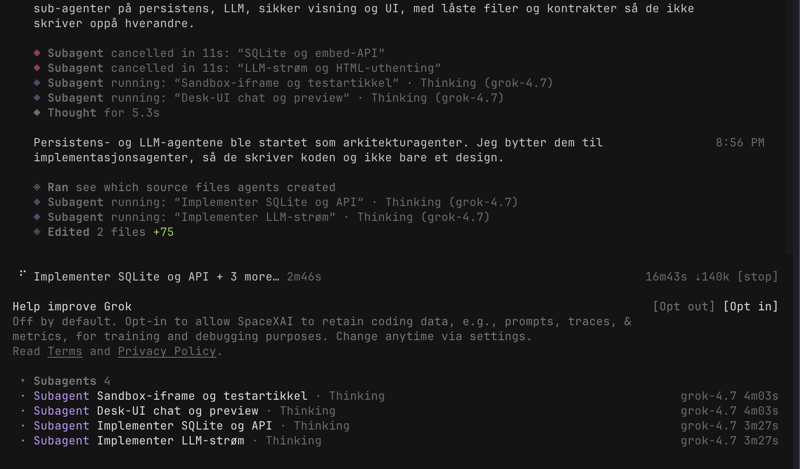

# Arbeidslogg

Jeg startet med dette prosjektet med å lese gjennom casen deretter forstå hva jeg skulle gjøre og kartlegge funksjonalitet. Så åpnet jeg en sterk modell med Thinking mode. Jeg har alltid en liten fremgangsmåte jeg liker å gjøre før jeg starter på ett nytt prosjekt eller noe ny funksjonalitet og det er denne prompten:

I want a deeper version of this task, not a bigger one. Before rewriting it: (1) say what a top professional in this field would do here that I'm not asking for; (2) name the rawest material they would start from instead of what has already been digested for me; (3) name the specific methods and tools they would use; (4) say what, other than you or me, would show the result is right. Then rewrite my prompt to ask for exactly that.

Så det jeg gjorde var å legge til casen ved starten av prompten for å gi modellen full kontekst før den begynte å generere løsningen også skrev jeg min egen prompt med de funksjonalitetene jeg tenkte og hva vi skulle fokusere på først i løsningen.  Så fikk jeg en fordypet prompt jeg kunne sende til en modell i terminalen for å starte opp prosjektet. Mens den jobbet med å generere løsningen så følgte jeg med lokalt og så på utviklingen og kunne komme med tilbakemeldinger underveis som havnet i kø. Dette var ekstra funksjonalitet og små tweaks som at mobil/desktop visningen ikke var optimalisert. 

Jeg fikk kun jobbet 2 timer med dette, så det er mye som jeg kunne gjort annerledes og fikset på, blant annet at jeg ikke fikk skrevet evals tester for å sjekke om alle funksjonalitetene fungerte som forventet. Jeg fikk ikke testet løsningen grundig selv, men fikk laget et lite halloween spill som fungerte lokalt. 

Jeg valgte å legge til streaming av hva agenten gjorde, støtte for vedlegg og opptakk av lyd for transkribering. For å være ærlig så fikk jeg ikke testet dette nøye og er usikker på kvaliteten for dette. Hadde jeg hatt mer tid ville jeg testet manuelt selv og satt opp en god del mer kode-tester(evals) og hatt agenter uten context som testet løsningen og kom med feedback på selve løsningen og ikke koden. Her kan man bruke f.eks Codex via nettleser for å teste localhost:3000 og ikke la agenten se i koden.

## Oppsett

Prosjektet ligger i `Documents/Amedia/lag-embeds`.

SvelteKit 3 (generert med `sv create`) bruker Vite-plugin for adapter, `#lib`-importer med filendelse, og `$app/env/private` via `src/env.ts`. Tailwind CSS v4 ligger i `src/routes/layout.css`.

SQLite går gjennom Node sin innebygde `node:sqlite` (`DatabaseSync`), ikke `better-sqlite3`. Det fjerner native bygg i Docker og matcher Node 22/26.

Orkestrerer: Grok. Sub-agenter får disjunkte filer og en låst kontrakt. De committer ikke.

## Sub-agenter

Kontekst som ble gitt: SvelteKit 3-regler (`#lib` med filendelse, `$app/env/private`, `Response.json`), at nøkkelen kan mangle, at alle spørringer filtrerer på eier, og at publisert HTML bare skal kjøre i `sandbox="allow-scripts"`. Sub-agentene committer ikke. Orkestratoren leser filene og integrerer dem.

- Persistens (generell agent): `node:sqlite`, embed-API, innlogging via cookie, tester. Leverte filer som ble beholdt. Fem tester grønne.
- LLM (generell agent): norsk systemprompt, streaming mot OpenAI og Anthropic, uthenting av HTML, `POST /api/chat`. Leverte filer som ble beholdt. Seks HTML-tester grønne. Agenten påpekte at cookien ikke er innlogging, så den som når serveren kan bruke `LLM_API_KEY`.
- Sikkerhet og UI (Svelte-spesialister): fikk samme kontrakt, men skrev ingen filer. De ble stoppet. Orkestratoren skrev `prepareEmbedDocument`, viewer, testartikkel og desk-komponentene selv, og kjørte Svelte autofixer på komponentene.

## Etterpå

Første måling av testartikkelen ble stående på 240 px. Editorens `srcdoc` krympet, fordi scriptet rakk å måle før rammen hadde fått høyde. `/view/[id]` lastes inn i en ramme som allerede er 240 px, og `documentElement.scrollHeight` er da minst vindushøyden. Høydemålingen bruker derfor innholdets boks. Verifisert i nettleseren: kort embed 51 px, høy blokk 656 px, tilbake til 51 px. Sandbox forble `allow-scripts`.

`pnpm test` (16), `pnpm check` og `pnpm exec eslint src` er grønne. `pnpm build` går gjennom.

`docker compose build` lager imaget på `node:22`. `node:sqlite` finnes der og skriver en embed. Adapter-node antar https, så `node build/index.js` avviste innloggingsskjemaet (`Cross-site POST form submissions are forbidden`). `scripts/serve.mjs` setter protokollen til http. I imaget gir innlogging 200, opprettelse 201, og kodesnutten peker på http.
